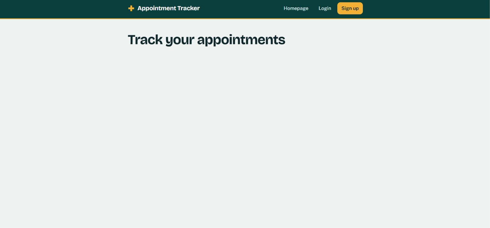
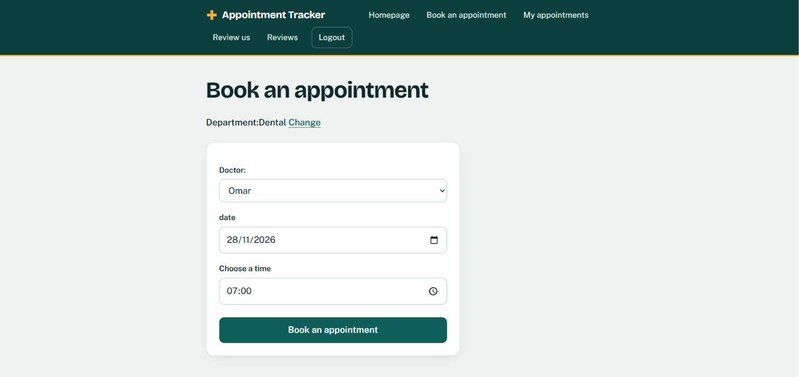
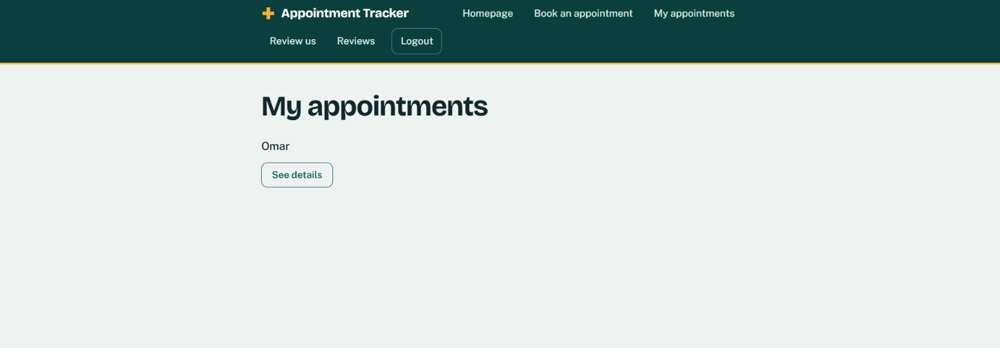
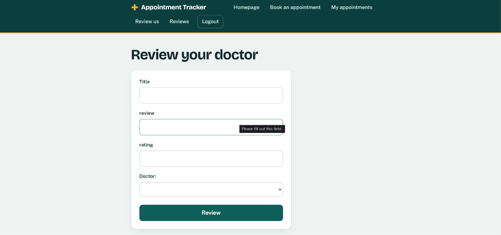
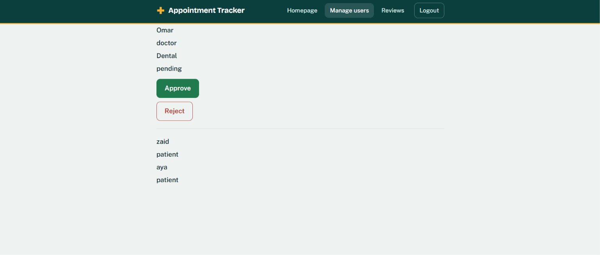
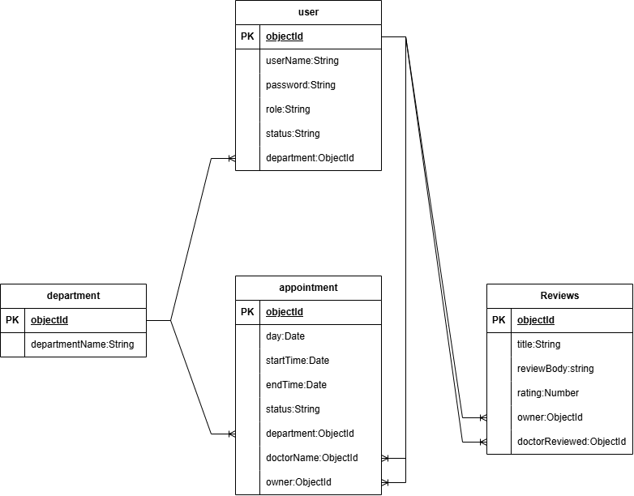

# Appointment Tracker

## Overview

This is a medical appointment tracking website you can sing up as a ptient or as a doctor (you will wait for approval) than book an appointment or be booked for one.
the user can change the time and the date of the appointment before its completed the patient will be able to review his doctor after his appointment is completed.

## Screenshots

**Home page**



**Book an appointment**



**My appointments**



**Reviews**



**Admin: manage users**



## Technologies Used

- **Node.js**
- **Express**
- **Mongoose**
- **EJS**
- **express-session** and **connect-mongo**
- **HTML5** and **CSS3**
- **draw.io**

## Getting Started

**1. Clone the repository**

```bash
git clone https://github.com/Redha-moh03/appointment-tracker.git
cd appointment-tracker
```

**2. Install dependencies**

```bash
npm install
```

**3. Create a `.env` file** in the project root:

```env
MONGODB_URI=mongodb://localhost:27017/appointment-tracker
SESSION_SECRET=replace_with_a_long_random_string
ADMIN_USERNAME=admin
ADMIN_PASSWORD=replace_with_a_strong_password
PORT=3000
```

**4. Seed the database.** This creates the departments (Dental, Diabetes, Physiotherapy, Oncology) and the admin account. Run it once:

```bash
node admin.js
```

**5. Start the app**

```bash
npm run dev    # development with nodemon
# or
npm start
```

Open [http://localhost:3000](http://localhost:3000).

**How to try it out**

1. Sign up as a **patient**, or as a **doctor** and choose a department.
2. Doctors can't sign in until an admin approves them. Sign in with the admin account and go to `/admin/users` to approve.
3. Sign in as a patient, open **Book an appointment**, and pick a department, doctor, date, and time.
4. Sign in as the doctor to see the schedule and mark the appointment as completed.
5. The patient can now leave a review.

## User Stories

**Patient**

- As a patient, I can create an account and sign in.
- As a patient, I can see every department and the approved doctors in each one.
- As a patient, I can book an appointment with a doctor on a date and time I choose.
- As a patient, I can't book two appointments at the same time.
- As a patient, I can see all of my appointments.
- As a patient, I can change the date and time of an appointment.
- As a patient, I can cancel an appointment.
- As a patient, I can review a doctor after a completed appointment.
- As a patient, I can read other patients' reviews.
  **Doctor**

- As a doctor, I can register for a department and wait for approval.
- As a doctor, I can see my schedule and the details of each appointment.
- As a doctor, I can mark an appointment as completed or cancel it.
  **Admin**

- As an admin, I can see all registered users.
- As an admin, I can approve or reject doctor registrations.

## Database Design



### User

| Field      | Type     | Notes                                                                          |
| ---------- | -------- | ------------------------------------------------------------------------------ |
| username   | String   | Required, unique                                                               |
| password   | String   | Required, stored as a bcrypt hash                                              |
| role       | String   | `patient` (default), `doctor`, or `admin`                                      |
| status     | String   | `approved` (default), `pending`, or `rejected`. New doctors start as `pending` |
| department | ObjectId | Ref: Department. Doctors only                                                  |

### Department

| Field          | Type   | Notes                       |
| -------------- | ------ | --------------------------- |
| departmentName | String | Required, max 40 characters |

### Appointment

| Field      | Type     | Notes                                           |
| ---------- | -------- | ----------------------------------------------- |
| day        | Date     | Required                                        |
| startTime  | Date     | Required                                        |
| endTime    | Date     | Required. Always 30 minutes after `startTime`   |
| status     | String   | `booked` (default), `completed`, or `cancelled` |
| department | ObjectId | Ref: Department                                 |
| doctorName | ObjectId | Ref: User (the doctor)                          |
| owner      | ObjectId | Ref: User (the patient)                         |

### Review

| Field          | Type     | Notes                                |
| -------------- | -------- | ------------------------------------ |
| title          | String   | Required, 10 to 40 characters        |
| reviewBody     | String   | Required, 10 to 500 characters       |
| rating         | Number   | Required, 0 to 10                    |
| owner          | ObjectId | Ref: User (the patient who wrote it) |
| doctorReviewed | ObjectId | Ref: User (the doctor)               |

### Relationships

- A **Department** has many doctors (**User**) and many **Appointments**.
- A **User** (patient) has many **Appointments** and writes many **Reviews**.
- A **User** (doctor) has many **Appointments** and receives many **Reviews**.
  All models use Mongoose `timestamps` (`createdAt`, `updatedAt`).

## Routes

| Method | Route                                | Description                                             |
| ------ | ------------------------------------ | ------------------------------------------------------- |
| GET    | /                                    | Home page                                               |
| GET    | /auth/sign-up                        | Sign up form                                            |
| POST   | /auth/sign-up                        | Create a patient or doctor account                      |
| GET    | /auth/sign-in                        | Sign in form                                            |
| POST   | /auth/sign-in                        | Sign in                                                 |
| GET    | /auth/sign-out                       | Sign out                                                |
| GET    | /book                                | Choose a department, then a doctor (patients only)      |
| POST   | /book/new                            | Create an appointment (patients only)                   |
| GET    | /my-appointment                      | List my appointments (patient) or my schedule (doctor)  |
| GET    | /details/:appointmentId              | View appointment details                                |
| GET    | /edit/:appointmentId                 | Edit appointment form                                   |
| PUT    | /edit/:appointmentId                 | Update appointment date and time                        |
| PUT    | /appointment/:appointmentId/cancel   | Cancel an appointment                                   |
| PUT    | /appointment/:appointmentId/complete | Mark an appointment as completed                        |
| GET    | /reviews                             | List all reviews                                        |
| GET    | /reviews/new                         | New review form (patients with a completed appointment) |
| POST   | /reviews/new                         | Create a review                                         |
| GET    | /reviews/:reviewId                   | View a review                                           |
| GET    | /admin/users                         | List all users (admin only)                             |
| PUT    | /admin/approve/:userId               | Approve a doctor (admin only)                           |
| PUT    | /admin/reject/:userId                | Reject a doctor (admin only)                            |

## Features

- Role-based accounts: patient, doctor, and admin
- Admin approval before a doctor can sign in
- Double-booking protection for both patients and doctors
- Reschedule or cancel an appointment
- Patients can review a doctor after a completed appointment

## Future Enhancements

- Let doctors edit their profile (bio, photo, working hours)
- Show only the free time slots for each doctor
- Show each doctor's average rating on the booking page
- Replace plain-text error messages with styled error pages and flash messages
- Appointment status badges and filters (upcoming, past, cancelled)

## Credits

- stack overflow
- W3Schools
